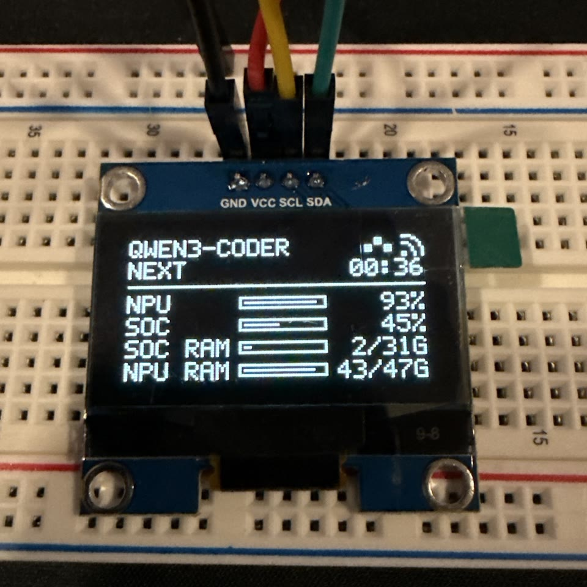
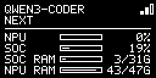
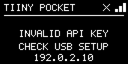
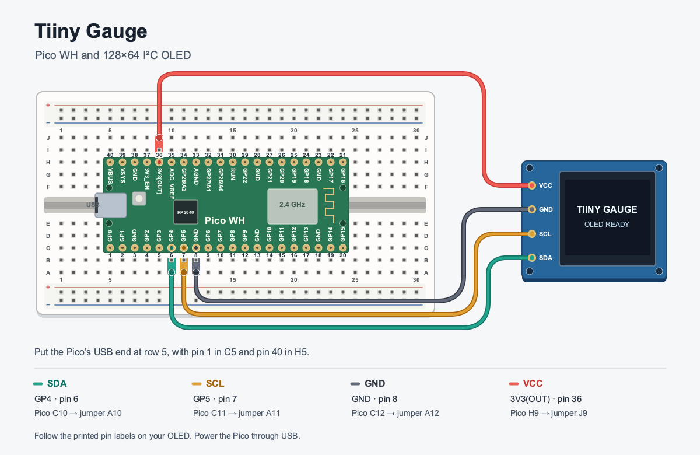
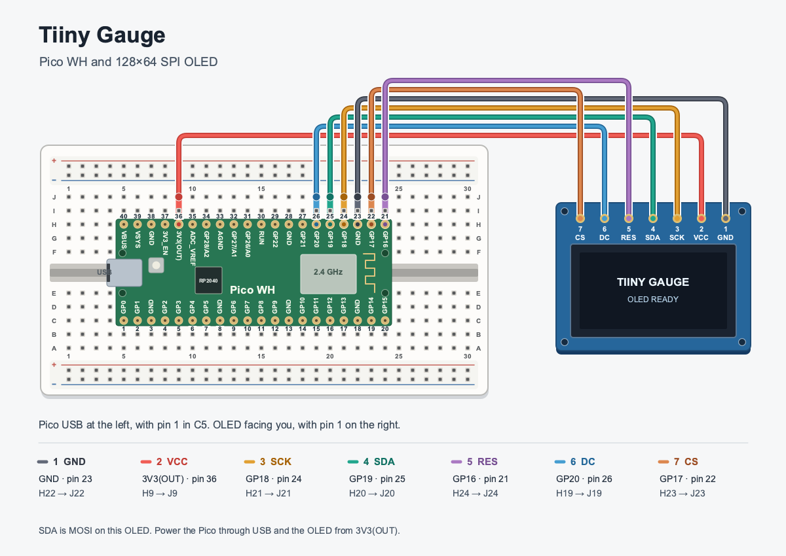

# Tiiny Gauge

A 128×64 OLED dashboard for Tiiny Pocket, built with Rust and Embassy on Pico W. It shows the loaded model, NPU and SoC utilization, memory usage, and elapsed inference activity over Wi-Fi.

The Blink Indicator defaults to **Off**. Enable it in USB setup to blink the Pico W’s onboard LED after each successful telemetry poll.



## OLED gallery

Rendered from the firmware at 2× scale with example telemetry. The loading GIF condenses a model load into a short loop.

| Connecting to Wi-Fi | Model loading |
| --- | --- |
|  |  |

| Idle | Inference |
| --- | --- |
|  |  |

| Tiiny unavailable | Wi-Fi reconnecting | Setup required |
| --- | --- | --- |
|  |  |  |

| Invalid API key | Access denied |
| --- | --- |
|  |  |

## Provision over USB

1. [Download and flash](#download-and-flash) the credential-free UF2 for your OLED, then leave the Pico connected to your computer with a USB data cable.
2. Open the **Tiiny Gauge** serial port at 115200 baud with local echo off. It usually appears as `/dev/cu.usbmodem*` on macOS, `/dev/ttyACM*` on Linux, or a COM port on Windows.
3. The menu shows the Gauge’s Wi-Fi network and current IP, the Tiiny IP, and whether an API key is set. Press Enter to refresh it if needed.

   ```text
   [1] Set WiFi Network
   [2] Set Tiiny IP
   [3] Set Tiiny API Key
   [5] Toggle Blink Indicator

   [8] Save & Restart
   [9] Discard Changes
   [0] Exit
   ```

4. Use **1–3** to enter your Wi-Fi settings, the Tiiny’s LAN IPv4 address, and its TiinyOS API key. The Pico echoes the SSID and IP, masks credentials, and supports Backspace.
5. Use **5** to switch the Blink Indicator between **On** and **Off**. A ` *` marks each unsaved change. Choose **8** to save and reboot or **9** to revert your edits and clear the markers.
6. Choose **0** to close the setup menu and discard unsaved edits. The Gauge keeps its saved settings and continues running. Type `SETUP` and press Enter to reopen the menu in the same serial session.

The Pico saves credentials in its onboard flash across reboots. Anyone with physical access can read that flash. Enable Wi-Fi auto-join in TiinyOS so the dashboard can resume polling after the Tiiny reboots at the configured address.

### Close `screen` on macOS

Press **Control+A**, release both keys, then press **Control+Backslash** and confirm with **y** if prompted. If the shortcut does nothing, open a second Terminal window, run `screen -ls`, and copy the full session ID for the Pico. Run `screen -S <session-id> -X quit` with that ID to close the session and release the serial port.

### Optional build-time configuration

Default builds ignore `.env` and credential environment variables. To embed settings in a private build, create a local `.env` with the values below and build with `--features baked-config`. Saved USB settings take precedence.

```dotenv
# Your 2.4 GHz Wi-Fi network
WIFI_SSID="Your Wi-Fi"
WIFI_PASSWORD="Your Wi-Fi password"

# Your Tiiny Pocket’s LAN IPv4 address and TiinyOS API key
TIINY_IP=192.168.1.100
TIINY_API_KEY="Your TiinyOS API key"
```

Git ignores `.env`. Keep firmware built with `baked-config` private.

## Reading the dashboard

The Pico polls the Tiiny over local HTTP every two seconds.

The retry screens show the configured Tiiny IP. If the OLED says **INVALID API KEY**, check the key in TiinyOS and update it through USB serial. **ACCESS DENIED** means the server at that address refused access.

The `SOC` meter shows the CPU utilization reported by TiinyOS. SoC RAM uses the reported usable total. `--/48G` means the dNPU has a rated capacity of 48 GB and the live memory counter is unavailable.

A descending arrow means a model is loading, with a percentage when TiinyOS supplies it. Three hopping dots indicate inference, with a timer that starts at the first poll with an active request. Rising Zs indicate idle.

## Wire the display

Use a 3.3 V-compatible 128×64 SSD1306 OLED. Connect by the labels on your display.

### I²C OLED

I²C uses address `0x3C` for both controllers. The default build targets SSD1306. If the dashboard is readable but has a thin strip of static along the right edge, try the SH1106 build. It applies the two-column offset that cleared the static on our test panel.

```sh
cargo build --release --locked --features oled-sh1106
```



| OLED | Pico W |
| --- | --- |
| SDA | GP4 (pin 6) |
| SCL | GP5 (pin 7) |
| GND | GND (pin 8) |
| VCC | 3V3(OUT) (pin 36) |

### SPI OLED

With the screen facing you and its header at the top, pin 1 is on the right. On this module, `SDA` is the SPI data input (MOSI).



| OLED pin | OLED label | Pico W |
| --- | --- | --- |
| 1 | GND | GND (pin 23) |
| 2 | VCC | 3V3(OUT) (pin 36) |
| 3 | SCK | GP18 (pin 24) |
| 4 | SDA | GP19 (pin 25) |
| 5 | RES | GP16 (pin 21) |
| 6 | DC | GP20 (pin 26) |
| 7 | CS | GP17 (pin 22) |

## Download and flash

Download the UF2 matching your display controller and wiring from [GitHub Releases](https://github.com/ewrogers/tiiny-gauge/releases/latest).

| OLED controller | I²C download | SPI download |
| --- | --- | --- |
| SSD1306 | `tiiny-gauge-v1.0.1-ssd1306-i2c.uf2` | `tiiny-gauge-v1.0.1-ssd1306-spi.uf2` |
| SH1106 | `tiiny-gauge-v1.0.1-sh1106-i2c.uf2` | `tiiny-gauge-v1.0.1-sh1106-spi.uf2` |

Hold **BOOTSEL** while plugging the Pico W into USB. Copy the UF2 to **RPI-RP2**, then [provision over USB](#provision-over-usb).

## Build from source

With Rust installed through rustup, run these commands from the repository root.

```sh
cargo build --release --locked
```

For SPI, use this build command instead.

```sh
cargo build --release --locked --features oled-spi
```

Convert the resulting firmware to UF2.

```sh
cargo install elf2uf2-rs --locked
elf2uf2-rs target/thumbv6m-none-eabi/release/tiiny-gauge target/tiiny-gauge.uf2
```

Hold **BOOTSEL** while plugging the Pico W into USB. Then copy `target/tiiny-gauge.uf2` to **RPI-RP2** or run `picotool load -v -x target/tiiny-gauge.uf2`. On first boot, [provision over USB](#provision-over-usb).
