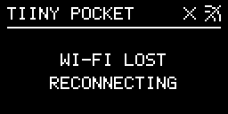
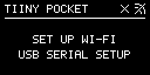

# Tiiny Gauge

A 128×64 OLED dashboard for Tiiny Pocket, built with Rust and Embassy on Pico W. It shows the loaded model, NPU and SoC utilization, memory usage, and elapsed inference activity over Wi-Fi.

## OLED gallery

Rendered from the firmware at 2× scale with example telemetry. The loading GIF condenses a model load into a short loop.

| Connecting to Wi-Fi | Model loading |
| --- | --- |
|  |  |

| Idle | Inference |
| --- | --- |
|  |  |

| Tiiny unavailable | Wi-Fi lost | Setup required |
| --- | --- | --- |
|  |  |  |

## Configuration

Copy `.env.example` to `.env` in the repository root, then fill in your values.

```dotenv
# Your 2.4 GHz Wi-Fi network
WIFI_SSID="Your Wi-Fi"
WIFI_PASSWORD="Your Wi-Fi password"

# Your Tiiny Pocket’s LAN IPv4 address and TiinyOS API key
TIINY_IP=192.168.1.100
TIINY_API_KEY="Your TiinyOS API key"
```

- Rebuild and flash after changing `.env`. Git ignores `.env`, and the built firmware embeds its credentials, so keep configured firmware images private.
- Enable Wi-Fi auto-join in TiinyOS. The dashboard resumes polling when the Tiiny rejoins at `TIINY_IP` after a reboot.

## Reading the dashboard

The Pico polls the Tiiny over local HTTP every two seconds.

The `SOC` meter shows the CPU utilization reported by TiinyOS. SoC RAM uses the reported usable total. `--/48G` means the dNPU has a rated capacity of 48 GB and the live memory counter is unavailable.

A descending arrow means a model is loading, with a percentage when TiinyOS supplies it. Three hopping dots indicate inference, with a timer that starts at the first poll with an active request. Rising Zs indicate idle.

## Wire the display

Use a 3.3 V-compatible 128×64 SSD1306 OLED. Connect by the labels on your display.

### I²C OLED

I²C uses address `0x3C` for both controllers. The default build targets SSD1306. If the dashboard is readable but has a thin strip of static along the right edge, try the SH1106 build. It applies the two-column offset that cleared the static on our test panel.

```sh
cargo build --release --locked --features oled-sh1106
```


| OLED | Pico W |
| --- | --- |
| SDA | GP4 (pin 6) |
| SCL | GP5 (pin 7) |
| GND | GND (pin 8) |
| VCC | 3V3(OUT) (pin 36) |

### SPI OLED

With the screen facing you and its header at the top, pin 1 is on the right. On this module, `SDA` is the SPI data input (MOSI).


| OLED pin | OLED label | Pico W |
| --- | --- | --- |
| 1 | GND | GND (pin 23) |
| 2 | VCC | 3V3(OUT) (pin 36) |
| 3 | SCK | GP18 (pin 24) |
| 4 | SDA | GP19 (pin 25) |
| 5 | RES | GP16 (pin 21) |
| 6 | DC | GP20 (pin 26) |
| 7 | CS | GP17 (pin 22) |

## Build and flash

With Rust installed through rustup, run these commands from the repository root.

```sh
cargo build --release --locked
```

For SPI, use this build command instead.

```sh
cargo build --release --locked --features oled-spi
```

Convert the resulting firmware to UF2.

```sh
cargo install elf2uf2-rs --locked
elf2uf2-rs target/thumbv6m-none-eabi/release/tiiny-gauge target/tiiny-gauge.uf2
```

Hold **BOOTSEL** while plugging the Pico W into USB. Then copy `target/tiiny-gauge.uf2` to **RPI-RP2** or run `picotool load -v -x target/tiiny-gauge.uf2`. The Pico reboots into the dashboard.
