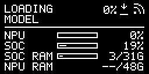
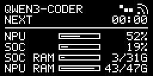
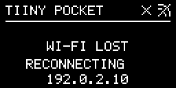
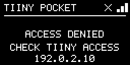
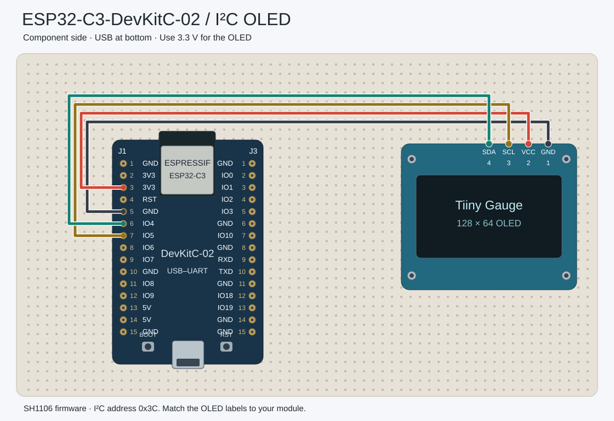
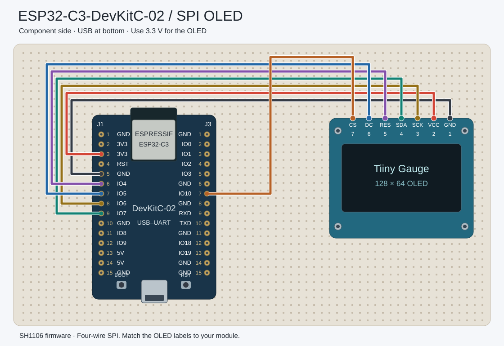

# Tiiny Gauge

A 128×64 OLED dashboard for Tiiny Pocket, built with Rust and Embassy. It shows the loaded model, NPU and SoC utilization, memory usage, and elapsed inference activity over Wi-Fi.

The Blink Indicator defaults to **Off**. Enable it in USB setup to blink the onboard LED after each successful telemetry poll.


## Supported hardware

Use a 3.3 V-compatible 128×64 monochrome OLED and a 2.4 GHz Wi-Fi network that can reach the Tiiny Pocket.

| Board | OLED and wiring | Release format |
| --- | --- | --- |
| Raspberry Pi Pico W | SSD1306 or SH1106 over [I²C](#i2c-oled) or [SPI](#spi-oled) | UF2 |
| ESP32-C3-DevKitC-02 (4 MB, USB-to-UART bridge) | SH1106 over [I²C](#esp32-c3-devkitc-02) | Merged ESP32-C3 BIN |

The ESP32-C3 release supports SH1106 I²C. The [ESP32-C3 wiring section](#esp32-c3-devkitc-02) also includes an SPI pinout for reference. Attach a 2.4 GHz antenna if your board uses the WROOM-02U module.

## OLED gallery

Rendered from the firmware at 2× scale with example telemetry. The loading GIF condenses a model load into a short loop.

The top-right Wi-Fi icon shows one bar for **Poor** (Tiiny unavailable below), two for **Good** (Idle), and three for **Excellent** (Inference). A slash marks disconnected Wi-Fi.

| Connecting to Wi-Fi | Model loading |
| --- | --- |
|  |  |

| Idle | Inference |
| --- | --- |
|  |  |

| Tiiny unavailable | Wi-Fi reconnecting | Setup required |
| --- | --- | --- |
|  |  |  |

| Invalid API key | Access denied |
| --- | --- |
|  |  |

## Provision over USB

1. Flash the [firmware for your board](#download-and-flash), then leave the board connected with a USB data cable.
2. Open the board’s serial port at 115200 baud with local echo off. On macOS, the Pico W usually appears as `/dev/cu.usbmodem*` and the ESP32-C3-DevKitC-02 as `/dev/cu.usbserial*`. On ESP32-C3, type `SETUP` and press Enter to open the menu.
3. The menu shows the Gauge’s Wi-Fi network, current IP, and signal strength, plus the Tiiny IP and whether an API key is set. Signal strength is sampled every two seconds. Press Enter to refresh the menu and see the latest reading, such as `Wi-Fi Signal: Good (-67 dBm)`.

   ```text
   [1] Set WiFi Network
   [2] Set Tiiny IP
   [3] Set Tiiny API Key
   [4] Toggle Blink Indicator

   [8] Save & Restart (Save & Apply on ESP32-C3)
   [9] Discard Changes
   [0] Exit
   ```

4. Use **1–3** to enter your Wi-Fi settings, the Tiiny’s LAN IPv4 address, and its TiinyOS API key. The Pico echoes the SSID and IP, masks credentials, and supports Backspace.
5. Use **4** to switch the Blink Indicator between **On** and **Off**. A ` *` marks each unsaved change. Choose **8** to save. Pico W restarts, while ESP32-C3 shows **Save & Apply** and reconnects with the saved settings. Choose **9** to revert your edits and clear the markers.
6. Choose **0** to close the setup menu and discard unsaved edits. The Gauge keeps its saved settings and continues running. Type `SETUP` and press Enter to reopen the menu in the same serial session.

Both boards save credentials in onboard flash across reboots. Anyone with physical access can read that flash. Enable Wi-Fi auto-join in TiinyOS so the dashboard can resume polling after the Tiiny reboots at the configured address.

### Close `screen` on macOS

Press **Control+A**, release both keys, then press **Control+Backslash** and confirm with **y** if prompted. If the shortcut does nothing, open a second Terminal window, run `screen -ls`, and copy the full session ID for the Pico. Run `screen -S <session-id> -X quit` with that ID to close the session and release the serial port.

### Optional build-time configuration

Default builds ignore `.env` and credential environment variables. To embed settings in a private build, create a local `.env` with the values below and build with `--features baked-config`. Saved USB settings take precedence.

```dotenv
# Your 2.4 GHz Wi-Fi network
WIFI_SSID="Your Wi-Fi"
WIFI_PASSWORD="Your Wi-Fi password"

# Your Tiiny Pocket’s LAN IPv4 address and TiinyOS API key
TIINY_IP=192.168.1.100
TIINY_API_KEY="Your TiinyOS API key"
```

Git ignores `.env`. Keep firmware built with `baked-config` private.

## Reading the dashboard

The Pico polls the Tiiny over local HTTP every two seconds.

The retry screens show the configured Tiiny IP. If the OLED says **INVALID API KEY**, check the key in TiinyOS and update it through USB serial. **ACCESS DENIED** means the server at that address refused access.

On ESP32-C3, press Enter in the setup menu to refresh the Wi-Fi status. `NoAccessPointFound` means the board could not find the saved network. Check the exact SSID, confirm that 2.4 GHz Wi-Fi is available, and attach a 2.4 GHz antenna if your module is a WROOM-02U.

The `SOC` meter shows the CPU utilization reported by TiinyOS. SoC RAM uses the reported usable total. `--/48G` means the dNPU has a rated capacity of 48 GB and the live memory counter is unavailable.

A descending arrow means a model is loading, with a percentage when TiinyOS supplies it. Three hopping dots indicate inference, with a timer that starts at the first poll with an active request. Rising Zs indicate idle.

## Wire the display

Use a 3.3 V-compatible 128×64 SSD1306 OLED. Connect by the labels on your display.

### I²C OLED

I²C uses address `0x3C` for both controllers. The default build targets SSD1306. If the dashboard is readable but has a thin strip of static along the right edge, try the SH1106 build. It applies the two-column offset that cleared the static on our test panel.

```sh
cargo build --release --locked --features oled-sh1106
```


| OLED | Pico W |
| --- | --- |
| SDA | GP4 (pin 6) |
| SCL | GP5 (pin 7) |
| GND | GND (pin 8) |
| VCC | 3V3(OUT) (pin 36) |

### SPI OLED

With the screen facing you and its header at the top, pin 1 is on the right. On this module, `SDA` is the SPI data input (MOSI).


| OLED pin | OLED label | Pico W |
| --- | --- | --- |
| 1 | GND | GND (pin 23) |
| 2 | VCC | 3V3(OUT) (pin 36) |
| 3 | SCK | GP18 (pin 24) |
| 4 | SDA | GP19 (pin 25) |
| 5 | RES | GP16 (pin 21) |
| 6 | DC | GP20 (pin 26) |
| 7 | CS | GP17 (pin 22) |

### ESP32-C3-DevKitC-02

The ESP32-C3 build supports the 128×64 SH1106 over I²C at `0x3C` or `0x3D`. It uses the same dashboard and polls the Tiiny every two seconds. The DevKitC-02’s USB-to-UART bridge carries the setup menu over UART0. The SPI diagram is a wiring reference. [Espressif’s DevKitC-02 pinout](https://docs.espressif.com/projects/esp-dev-kits/en/latest/esp32c3/esp32-c3-devkitc-02/user_guide.html#header-block)



| OLED signal | DevKitC-02 header | WROOM-02/02U module pad |
| --- | --- | --- |
| GND | J1 pin 5 (GND) | 9 |
| VCC | J1 pin 3 (3V3) | 1 |
| SCL | J1 pin 7 (GPIO5) | 4 |
| SDA | J1 pin 6 (GPIO4) | 3 |

Power the DevKitC-02 over USB and the OLED from 3V3. Match the signal labels on your OLED since I²C header order varies. Use pull-ups to 3V3 if the OLED board has none. For a bare WROOM-02U module, follow Espressif’s reference circuit and attach a 2.4 GHz antenna. The J1 and J3 numbers refer to DevKitC-02 headers. [WROOM-02/02U datasheet](https://documentation.espressif.com/esp32-c3-wroom-02_datasheet_en.html)



| SPI OLED pin (pin 1 on the right) | DevKitC-02 header | WROOM-02/02U module pad |
| --- | --- | --- |
| 1 GND | J1 pin 5 (GND) | 9 |
| 2 VCC | J1 pin 3 (3V3) | 1 |
| 3 SCK | J1 pin 8 (GPIO6) | 5 |
| 4 SDA (MOSI) | J1 pin 9 (GPIO7) | 6 |
| 5 RES | J1 pin 6 (GPIO4) | 3 |
| 6 DC | J1 pin 7 (GPIO5) | 4 |
| 7 CS | J3 pin 7 (GPIO10) | 10 |

Build and flash with `espflash` installed. The partition table reserves space for your settings on the 4 MB DevKitC-02. After flashing, open the serial port and [provision over USB](#provision-over-usb).

```sh
rustup target add riscv32imc-unknown-none-elf
cargo build --release --locked --target riscv32imc-unknown-none-elf --features esp32c3
espflash flash --partition-table firmware/esp32c3-partitions.csv target/riscv32imc-unknown-none-elf/release/tiiny-gauge
```

## Download and flash

Download the firmware for your board and display from [GitHub Releases](https://github.com/ewrogers/tiiny-gauge/releases/latest). The release builds ship without credentials.

### Pico W downloads

| OLED controller | I²C download | SPI download |
| --- | --- | --- |
| SSD1306 | `tiiny-gauge-v1.1.0-ssd1306-i2c.uf2` | `tiiny-gauge-v1.1.0-ssd1306-spi.uf2` |
| SH1106 | `tiiny-gauge-v1.1.0-sh1106-i2c.uf2` | `tiiny-gauge-v1.1.0-sh1106-spi.uf2` |

Hold **BOOTSEL** while plugging the Pico W into USB. Copy the UF2 to **RPI-RP2**, then [provision over USB](#provision-over-usb).

### ESP32-C3 download

Download `tiiny-gauge-v1.1.0-esp32c3-sh1106-i2c.bin`. It includes the bootloader, partition table, and application. Close any serial terminal and run the command below with `esptool` installed. Plug in just the ESP32-C3 or select its port with `--port`.

```sh
esptool --chip esp32c3 write-flash 0x0 tiiny-gauge-v1.1.0-esp32c3-sh1106-i2c.bin
```

If automatic download mode fails, hold **BOOT**, tap **RST**, and release **BOOT** before retrying with `--before no-reset` before `write-flash`. The image ends before the settings partition. After flashing, [provision over USB](#provision-over-usb).

## Build Pico W firmware from source

With Rust installed through rustup, run these commands from the repository root.

```sh
cargo build --release --locked
```

For SPI, use this build command instead. For SH1106, add `oled-sh1106` to `--features` (use `--features oled-spi,oled-sh1106` for SPI).

```sh
cargo build --release --locked --features oled-spi
```

Convert the resulting firmware to UF2.

```sh
cargo install elf2uf2-rs --locked
elf2uf2-rs target/thumbv6m-none-eabi/release/tiiny-gauge target/tiiny-gauge.uf2
```

Hold **BOOTSEL** while plugging the Pico W into USB. Then copy `target/tiiny-gauge.uf2` to **RPI-RP2** or run `picotool load -v -x target/tiiny-gauge.uf2`. On first boot, [provision over USB](#provision-over-usb).
